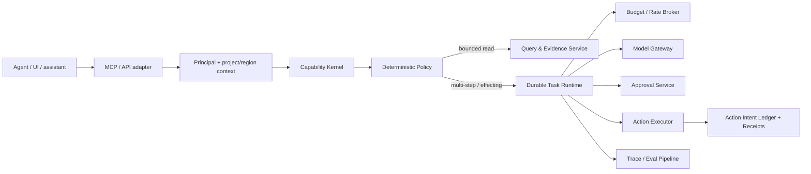

# Agent-Safe MCP for Product Analytics

[](https://github.com/yasuss/agent-safe-mcp-for-product-analytics/actions/workflows/design-checks.yml)
[](LICENSE)

**An implementable architecture for letting AI agents query a customer's product
analytics and take bounded actions through MCP, API and UI — without ever letting the
model decide what it is allowed to do.**

The reference question an agent receives:

> *"Why did signup conversion drop this week, and if you find the cause, create
> something useful to help me fix or monitor it."*

Answering it means running several expensive queries over private customer data, forming
hypotheses without overclaiming causality, creating dashboards or alerts, and possibly
proposing a production change such as a feature-flag rollback — for any MCP client, on
behalf of a real user, inside one project and one region.

---

## The problem

Exposing analytics APIs as MCP tools is easy. Making that safe is not:

- **The agent is not trustworthy.** Event properties, error messages and replay text are
  customer-controlled and can carry prompt injection.
- **MCP tool annotations are hints**, and client-side approval prompts differ by client.
  Neither is a security boundary.
- **Writes are retried.** A dashboard or alert can be created while the response is lost;
  a blind retry creates a duplicate — or worse, changes a production flag twice.
- **Access changes mid-task.** A user can lose permission while a multi-step
  investigation is still running.
- **Analytics is variable-cost.** One unbounded query or a runaway tool loop can cost more
  than the whole task is worth.
- **"The agent answered" is not "the task succeeded."** Correlation presented as cause is
  a wrong answer, however fluent.

## Design in one sentence

A **project-bound capability kernel** — server-owned typed capabilities shared by UI,
in-product assistants and external MCP/API clients — with **deterministic authorization
at every execution boundary**, a **synchronous path for bounded reads**, a **durable
task/action plane** for investigations, approvals and writes, an **action-intent ledger
with reconciliation**, **hierarchical budgets**, and **task-level receipts and evals**.

> **The model proposes. The capability/policy layer authorizes. The executor effects.
> The verifier proves what happened.**

## Core invariants

1. **Agent ≠ authority.** The model proposes; server policy authorizes.
2. **One task → one organization, project and region** by default. No implicit
   cross-project or cross-region access.
3. **Tool availability is not permission.** Discovery is filtered; every call is authorized.
4. **Effects are risk-tiered:** read → automatic; reversible internal write → automatic
   only if delegated; destructive / external / production → exact human confirmation;
   forbidden → denied.
5. **Durability ≠ exactly-once.** Every write has an action intent, idempotency or
   reconciliation, and a receipt.
6. **Re-authorize every effect.** Revocation mid-task stops all later effects.
7. **Customer data is untrusted input.** It can change a proposal; it cannot grant a
   capability, widen a task's purpose or open egress.
8. **Evidence before causality.** Observational analytics yields hypotheses with evidence,
   not proven causes.

## Architecture at a glance



MCP is a transport and discovery surface, **not** the security boundary. The same
capability backend serves the product UI, in-product agents and external MCP/API clients,
so there is one safety implementation, not three.

Full design: [docs/architecture.md](docs/architecture.md) — capability contract, identity
and delegated authorization, project/region binding, dual execution path, query and
evidence layer, budgets, risk tiers, action-intent ledger, prompt injection and egress,
approval UX, receipts, evals, failure behaviour, external providers and scaling.

## The write path

```text
model proposal
  → canonical ActionIntent (scope injected server-side, never from model args)
  → deterministic authorization at execution (current permission, scope, tier, budget, egress)
  → [Tier 2: exact confirmation bound to action digest + principal + project + resource version + policy + expiry]
  → reserve budget lease + idempotency record
  → execute
  → lost response?  OUTCOME_UNKNOWN → reconcile by stable fingerprint → existing receipt | proven-absent retry | review
  → verify postcondition
  → user-visible ActionReceipt
```

A step-by-step walk through the conversion-drop question:
[docs/walkthrough.md](docs/walkthrough.md).

## Decisions and alternatives

| Decision | Chosen | Alternatives considered | Revisit when |
| --- | --- | --- | --- |
| [Overall shape](docs/decisions/ADR-0001-capability-kernel.md) | Project-bound capability kernel + durable task/action plane | Current MCP controls only; thin MCP façade with client confirmation; intent-only workflow catalog; separate universal agent OS; broad autonomous sandbox | a single platform service already provides these semantics; the product becomes read-only; code execution across many systems dominates |
| [Authority](docs/decisions/ADR-0002-authorization-at-execution-boundary.md) | Deterministic policy re-checked at every effect | Trust MCP annotations / client approval; LLM risk classification | — |
| [Scope](docs/decisions/ADR-0003-task-scope-and-principals.md) | Immutable org/project/region scope; human, client and task identities kept separate | Model-supplied project IDs; inherited blanket tokens for scheduled tasks | cross-project analysis becomes a first-class use case (explicit capability) |
| [Actions](docs/decisions/ADR-0004-risk-tiers-and-exact-confirmation.md) | Four risk tiers; exact, one-shot confirmation for Tier 2 | Confirm every write; "approve all"; client-side prompts | — |
| [Retries](docs/decisions/ADR-0005-action-intent-ledger.md) | Action-intent ledger, provider idempotency, reconciliation before retry | Rely on workflow retries; claim exactly-once | — |
| [Execution](docs/decisions/ADR-0006-dual-execution-path.md) | Sync bounded reads + durable tasks on the existing workflow engine | Everything async; a second, agent-only workflow engine | measured load shows the shared task queue is insufficient |
| [Cost](docs/decisions/ADR-0007-hierarchical-budgets.md) | Hierarchical budgets with leases reserved before execution | One global rate limit; token-only budgets | — |
| [Quality](docs/decisions/ADR-0008-evidence-and-outcome-evals.md) | Hypothesis ledger with evidence; outcome-level evals | Model-response evals only; causal claims from correlation | — |

Deliberately **not** in the first version: a second workflow engine, an agent-only
analytics database, a general-purpose network sandbox in the analytics path, LLM-based
authorization, a new event bus, mandatory MCP Tasks support in every client, a
cross-provider orchestrator. Full comparison, challenge reviews and repair loop:
[docs/alternatives.md](docs/alternatives.md).

## Failure modes it is designed for

| Scenario | Behaviour |
| --- | --- |
| Write succeeded, response lost | `OUTCOME_UNKNOWN` → reconcile by fingerprint → return existing receipt; one empty read under eventual consistency is not proof of absence |
| Prompt injection in event data: "grant admin, send data out" | Cannot mint a capability, change scope, open egress or self-approve |
| Access revoked mid-task | Next execution-boundary check fails → `ACCESS_REVOKED`; an earlier approval does not override it |
| Expensive query or runaway loop | Rejected or narrowed before dispatch by the budget broker; the agent cannot raise its own limits |
| Cross-project request | Denied unless an explicit cross-project capability and allowlist exist |
| Parameters or resource changed after approval | Digest or resource version mismatch → new approval required |
| Cancellation | Stops new steps; in-flight effects are reconciled; cancellation is not rollback |

Full adversarial review and residual risks: [docs/failure-modes.md](docs/failure-modes.md).

## Executable design checks

The authority and action semantics are modelled in a stdlib-only reference model that runs
in CI:

```bash
python verification/reference_model.py
```

23 checks cover scope and region denial, mid-task revocation, pre-dispatch budget denial,
Tier-1 automatic writes with receipts, idempotency-key parameter mismatch, lost-response
reconciliation, deduplicated retries, exact confirmation that cannot be replayed, invalidation on changed
parameters or resource version, approval not overriding revocation, prompt injection not
expanding authority, undeclared egress, least-privilege scheduled principals,
cancellation, budget lease reconciliation, canonical digests — plus a negative
calibration that proves the suite catches a policy which trusts the model. See
[verification/README.md](verification/README.md) and the traceability in
[docs/requirements.md](docs/requirements.md).

## Reference stack

| Layer | Choice |
| --- | --- |
| Capability kernel, policy, executor, query service | Python modules inside the product backend — logical components, not one microservice each |
| MCP transport adapter | TypeScript MCP server projecting the capability registry |
| Control state: tasks, intents, approvals, receipts, budget leases | PostgreSQL |
| Analytics queries | Columnar analytics store (ClickHouse-class) through a read-only query role |
| Durable tasks, approval waits, schedules | Temporal (the platform's existing durable workflow engine) |
| Rate and budget counters | Redis |
| Model access | AI gateway with provider policy, redaction and cost attribution |
| Traces and evals | OpenTelemetry-compatible traces feeding an eval pipeline |

Why reuse the existing workflow engine instead of building one:
[ADR-0006](docs/decisions/ADR-0006-dual-execution-path.md).

## Implementing it

- **Reference path** — follow [docs/architecture.md](docs/architecture.md) and the staged
  rollout in [docs/rollout-and-migration.md](docs/rollout-and-migration.md):
  read-only pilot → Tier-1 analytical artifacts → durable and scheduled investigations →
  Tier-2 actions one family at a time → external providers.
- **With Agent Reliability Runtime** — the kernel's authority and effect semantics
  (exact approval, effect receipts, reconciliation, postcondition verification, untrusted
  content, deterministic evals) are implemented and tested in
  [Agent Reliability Runtime](https://github.com/yasuss/agent-reliability-runtime), a
  Python runtime with a framework-neutral core. ARR's extension ports map onto this
  architecture, including interface-only ports for task scope, budgets and risk-tiered
  capabilities. Mapping: [docs/implementing-with-arr.md](docs/implementing-with-arr.md).

## Repository map

```text
docs/
  architecture.md            full system design
  requirements.md            constraints, acceptance criteria, traceability
  walkthrough.md             the conversion-drop question end to end, plus design Q&A
  alternatives.md            six architecture options, challenge reviews, repair loop
  decisions/                 architecture decision records (ADR-0001 … ADR-0008)
  failure-modes.md           adversarial review and residual risks
  rollout-and-migration.md   risks, staged rollout, kill switches, ownership
  open-questions.md          facts deliberately not assumed, and how each is resolved
  implementing-with-arr.md   mapping to Agent Reliability Runtime ports
  references.md              primary sources behind load-bearing decisions
verification/
  reference_model.py         executable model of authority and action semantics
```

## Scope

This repository is an architecture specification with an executable reference model. It
contains no production connectors and makes no claim about any specific vendor's internal
systems. Scale, latency targets and provider-specific reconciliation rules must be measured
and fault-tested during implementation — see [docs/open-questions.md](docs/open-questions.md).

## License

[Apache License 2.0](LICENSE).
