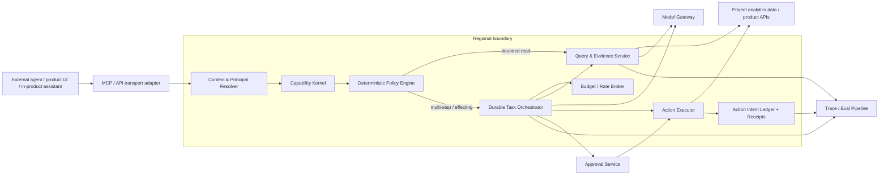

# Architecture — Project-Bound Capability Kernel + Durable Task/Action Plane

> Companion documents: [requirements](requirements.md) · [walkthrough](walkthrough.md) · [alternatives](alternatives.md) · [decisions](decisions/) · [failure modes](failure-modes.md) · [rollout and migration](rollout-and-migration.md) · [open questions](open-questions.md) · [implementing with ARR](implementing-with-arr.md)

## 1. Goals and non-goals

### Goals
- Let agents ask analytical questions and take bounded useful actions through MCP/API/UI.
- Preserve the same security semantics across all surfaces.
- Make writes retry-safe and auditable.
- Support seconds-long reads and minutes/hours-long investigations or approval pauses.
- Bound model/query/tool cost before it becomes unbounded.
- Keep customer/project/region boundaries deterministic.
- Make task quality and action correctness measurable.

### Non-goals for the first release
- A general-purpose cross-SaaS automation platform.
- Arbitrary shell/network access.
- Automatic production remediation.
- Cross-project reasoning by default.
- A claim of causal proof from observational analytics.
- Exactly-once side effects across arbitrary providers.

## 2. High-level architecture



**Assumed existing platform primitives:** a hosted MCP endpoint, regional (e.g. US/EU) routing, project-scoped analytics data and queries, product APIs, an AI/model gateway and a durable workflow engine.  
**Introduced by this design:** the `Capability Kernel`, risk-policy metadata, `ActionIntent` ledger, approval digest, evidence/hypothesis records and uniform adapter contracts.

## 3. The interface: stable capabilities, not raw model authority

A capability is a server-owned contract. MCP tools are one projection of that contract; UI/API/internal-agent surfaces are other projections.

Example conceptual contract:

```ts
interface CapabilityDefinition<Input, Output> {
  id: string                 // e.g. analytics.query.v1
  version: number
  provider: 'analytics'
  inputSchema: JSONSchema
  outputSchema: JSONSchema
  scope: 'project'
  requiredPermissions: string[]
  riskTier: 0 | 1 | 2 | 3
  effect: 'read' | 'internal_write' | 'external' | 'production'
  reversible: boolean
  idempotency: 'read' | 'provider_key' | 'reconcile' | 'not_auto_retryable'
  dataClasses: string[]
  egressClass: 'none' | 'model' | 'external_provider'
  defaultBudgetClass: string
  confirmation: 'none' | 'exact_action'
  autonomousEffectLimit: number
}
```

### Why both intent-level and primitive tools

Use **intent-level capabilities** for stable, high-value agent workflows such as:
- `analytics.investigate_conversion_drop`
- `analytics.create_monitor_from_finding`
- `errors.investigate_spike`

Keep **narrow primitive capabilities** for exploratory analysis:
- query a funnel/time series;
- read an insight/dashboard/error group;
- create a specific analytical artifact.

Do not expose unrestricted generic CRUD merely because the underlying API has it. But do not force every new analytical question into a new workflow either. The capability registry gives both forms the same authorization, budget and receipt semantics.

### MCP annotations

Derive `readOnlyHint`, `destructiveHint`, `idempotentHint`, and `openWorldHint` from capability metadata for client UX. Never use them as the authorization decision; MCP explicitly treats these as hints [R3].

## 4. Identity and authorization

### Interactive principal

An external client acts on behalf of a logged-in human user through OAuth. Persist three identities separately:
- `human_principal_id`
- `agent_client_id` / session identity
- optional `task_principal_id`

Effective capability is the intersection of:
1. current human/project permission in the product;
2. OAuth/token scope;
3. task-bound capability grant;
4. policy/risk rule;
5. current budget/region/data-egress policy.

### Scheduled/background principal

A scheduled task receives a dedicated task/service identity with:
- exact org/project/region;
- finite capability allowlist bound to the configured task purpose;
- expiry/revocation epoch and accountable owner/admin grant;
- cost/rate ceilings;
- no inherited blanket human token.

### Re-check at execution

Authorization is not a one-time admission check. Every query and effecting action evaluates current permission. After an approval pause or worker restart, the executor re-evaluates before the next side effect. A revoked user/task becomes `ACCESS_REVOKED` and can no longer mutate anything.

## 5. Project and region binding

`TaskScope` is immutable for a normal task:

```json
{
  "organization_id": "...",
  "project_id": "...",
  "region": "EU",
  "principal_ref": "...",
  "capability_grants": ["analytics.read", "artifact.write"],
  "allowed_resource_ids": []
}
```

The agent never supplies a free-form project ID downstream after task creation. The executor injects project scope outside the model-controlled argument object.

Projects are data silos: every query is project-specific, so project scope is a server-side fact, never a model argument.

Cross-project work is a separate explicit capability with a project allowlist and per-project authorization/provenance. There is no conversationally inferred cross-project access.

Region is resolved at authentication/task creation and stays region-affine. No silent US↔EU fallback. Model egress is a separate decision: organization AI-processing policy + allowed provider/model + data minimization/redaction + audit of the data class sent.

## 6. Dual execution path

### Fast synchronous path
Use when all are true:
- read-only;
- one or a small bounded number of calls;
- predictable query envelope;
- no approval;
- no durable retry needed.

Path:
`MCP/API -> principal/scope -> capability -> policy -> query -> evidence -> result`

### Durable task path
Use for:
- multi-step investigations;
- multiple potentially expensive queries;
- model reasoning across evidence;
- any effecting write with uncertain network failure semantics;
- approval pause;
- scheduled recurring work.

Suggested task state machine:

```text
CREATED
  -> AUTHORIZED
  -> INVESTIGATING
  -> AWAITING_APPROVAL
  -> EXECUTING
  -> VERIFYING
  -> COMPLETED

Terminal/exception states:
FAILED | CANCELLED | BUDGET_EXHAUSTED | ACCESS_REVOKED | OUTCOME_UNKNOWN
```

MCP 2026-07-28 Tasks can expose a durable handle/polling/input-required UX when the client supports it. The backend runtime remains durable independently of MCP transport version [R1] [R2].

## 7. Analytics query and evidence layer

The model does not directly get a database credential. It asks for a typed analytical operation.

The Query/Evidence Service:
- injects project/region outside model control;
- validates query family/schema;
- enforces date-window/result-row/time budgets;
- uses read-only execution for analytical queries;
- returns structured evidence with provenance rather than an untyped text blob;
- minimizes raw event/person fields before model context;
- labels text-bearing results as untrusted data.

Example evidence record:

```json
{
  "evidence_id": "ev_123",
  "query_fingerprint": "sha256:...",
  "project_id": "p1",
  "time_window": ["...", "..."],
  "metric": "signup_conversion",
  "cohort": {"browser": "Safari"},
  "result_summary": {"delta_pct": -18.2},
  "source_class": "project_analytics",
  "trust": "UNTRUSTED_DATA",
  "data_quality_notes": [],
  "collected_at": "..."
}
```

Analytics backends already impose query rate, read-volume and timeout limits; the query service makes them explicit admission rules instead of runtime surprises.

## 8. Budget and rate broker

Use hierarchical budgets rather than one global rate limit:
- per task;
- per user/task principal;
- per organization/project;
- per model provider;
- per query class.

A `BudgetLease` is reserved before an expensive step. The task cannot spend merely because the model asks again. After the step, reconcile estimated vs actual usage and release/charge the lease so retries cannot double-count or escape the envelope.

Possible dimensions:
- max model currency/tokens;
- max analytics queries;
- max expensive-query class count;
- max rows/context bytes returned;
- max tool steps;
- wall-clock deadline;
- concurrency slots;
- external egress actions.

On exhaustion: stop, degrade to a cheaper/bounded query, or request a user-approved budget increase. Scheduled jobs get jitter/fair scheduling to avoid synchronized bursts. Exact thresholds are deployment configuration, not fixed numbers in this design.

## 9. Deterministic action policy

### Tier 0 — READ
Automatic if current scope, data and budget policy allow it.

### Tier 1 — reversible internal analytical write
Automatic only if the capability was explicitly delegated. Requirements:
- deterministic authorization;
- stable action intent/idempotency key;
- before/after or resulting-resource receipt;
- undo path;
- postcondition verification.

### Tier 2 — destructive, external or production-affecting
Requires exact human confirmation. Confirmation must show:
- target project/resource;
- exact mutation/diff;
- evidence that motivated it;
- blast radius where knowable;
- external destination/data class;
- estimated material cost if relevant.

The approval binds `action_digest + project + principal + policy_version + expiry`. If arguments change after approval, the approval is invalid.

### Tier 3 — forbidden/sensitive
Deny. Examples: scope escalation, credential exfiltration, disallowed provider egress, implicit cross-project action.

## 10. Action intent ledger: retries without pretending exactly-once

The most important write-path object is not the tool call; it is the server-side `ActionIntent`.

```text
RESERVED -> DISPATCHED -> ACKNOWLEDGED -> VERIFIED
                     \-> OUTCOME_UNKNOWN -> RECONCILING -> VERIFIED | NEEDS_REVIEW
                     \-> FAILED
VERIFIED -> ROLLED_BACK (if supported)
```

Fields:
- `intent_id`
- task/project/principal
- capability+version
- canonical argument hash
- provider idempotency key
- policy decision/version
- approval digest if any
- dispatch attempts
- resulting resource ID/version
- verification result
- receipt timestamp

### Lost response after successful write

Never blindly retry a non-proven-idempotent mutation.

1. Persist `ActionIntent` before dispatch.
2. Dispatch with provider idempotency key if supported.
3. If response is lost, mark `OUTCOME_UNKNOWN`.
4. Reconcile by reading the target using a stable external reference/fingerprint.
5. If the effect is found, mark `VERIFIED` and return the existing receipt.
6. If absence is proven under provider-specific uniqueness/convergence rules, retry the same intent. Eventual consistency means a single empty read is not automatically proof of absence.
7. If outcome cannot be established, especially for a high-impact action, stop for review rather than duplicating it.

Durable workflow engines execute activities at least once — Temporal's own guidance is that activities should be idempotent because they may run more than once [R5]. Durability therefore does not remove side-effect idempotency requirements.

## 11. Prompt injection and egress

Threat model: customer data, error messages, replay text, support content, tool descriptions/results and external provider content can contain malicious instructions.

Controls:
- all such content receives provenance/trust labels;
- the model never controls project scope, capability grants, credentials or policy metadata;
- dynamic tool registration/permission mutation is not allowed inside a task;
- the durable task grant/purpose is created only from trusted user/admin configuration; untrusted retrieved text cannot widen that purpose, and autonomous-effect count is bounded;
- secrets are fetched by the executor from a broker, not placed in model context;
- external network destinations are capability/egress allowlisted;
- model-provider egress is separately policy-checked and data-minimized;
- high-impact actions based on untrusted evidence still pass deterministic policy/confirmation;
- prompt filters/detectors are defense-in-depth, not the authority boundary.

This is consistent with OWASP guidance and empirical prompt-injection benchmarks [R6] [R7] [R8].

## 12. Approval UX

The approval card is a trusted UI/MCP input request generated from the server-side `ActionIntent`, not a model-authored paragraph.

Example:

```text
Proposed action: Reduce feature flag checkout-v2 rollout 50% -> 10%
Project: Production / EU
Why: signup conversion drop is concentrated in flag cohort; evidence remains observational
Blast radius: users currently matching the release condition
External effect: yes, changes production behavior
[Approve exact change] [Reject] [Open evidence]
```

MCP MRTR/Tasks `input_required` can carry the interaction, but the server validates the returned approval against the exact action digest.

## 13. Audit and user-visible receipts

Every completed effect returns an `ActionReceipt`:
- initiating human;
- agent/client;
- task/service principal;
- org/project/region;
- capability/version;
- policy decision/version;
- approval reference if any;
- idempotency/action intent;
- resource before/after or created ID;
- verification result;
- model/query/tool cost attribution;
- timestamp and trace ID.

This receipt is user-facing evidence, not only an internal log.

## 14. Evals and observability

Evaluate at **task outcome** level, not only model-response level.

### Deterministic safety/effect checks
- cross-project leakage: zero tolerated;
- policy violation attempts blocked;
- exact approval binding;
- duplicate-effect rate after retries;
- unauthorized egress;
- budget enforcement;
- action postcondition verification.

### Semantic quality
- diagnosis correctness;
- evidence coverage;
- unsupported-claim rate;
- calibrated uncertainty;
- hypothesis ranking;
- user correction rate.

### Product outcome
- time to useful answer;
- artifact kept/used vs deleted/reverted;
- monitor usefulness;
- task completion without manual repair;
- cost per successful task.

Persist tool/model/capability versions on task traces so eval regressions are attributable. Trace/eval payloads follow the same region, classification, redaction and retention policy as runtime data; receipts prefer identifiers/hashes/derived summaries over raw customer payloads.

## 15. Concrete scenario: “Why did signup conversion drop this week?”

1. Resolve OAuth principal and pin org/project/region.
2. Start `analytics.investigate_conversion_drop`; choose sync or task path from boundedness.
3. Reserve a task budget.
4. Establish data health: funnel definition, timezone, ingestion anomalies, comparison window.
5. Decompose the funnel by step and identify where the delta appears.
6. Test bounded cohorts: browser/device/source/landing path/new-vs-returning and other domain-relevant segments.
7. Pull nearby product evidence only through granted capabilities: annotations/deploy markers, errors/replays, feature-flag cohorts.
8. Maintain hypotheses with evidence for/against, confidence and `observational | experimental` label.
9. Stop when budget or evidence sufficiency threshold is reached; do not create a causal claim from temporal correlation.
10. If useful, automatically create a Tier-1 dashboard/insight/annotation/monitor using one `ActionIntent` per effect.
11. Verify the artifact exists with the intended parameters and emit receipts.
12. If the model proposes a feature-flag rollback or other production fix, create a Tier-2 action proposal and pause for exact confirmation.
13. Return a user-facing answer containing the evidence trail, caveats, created artifact and task/action receipts.

## 16. Failure behavior

### Lost response after successful write
`OUTCOME_UNKNOWN -> reconcile -> verified existing effect or safe retry`; never blind duplicate.

### Prompt injection
Injected text can alter a model proposal but cannot mint a capability, change project/region, grant egress or self-approve an action.

### Access revoked mid-task
Next execution-boundary authorization fails; task becomes `ACCESS_REVOKED`; further effects stop. Reauthorization creates a fresh auth epoch.

### Expensive query
Admission/budget broker rejects or narrows the query before unbounded execution; the agent may propose a smaller window/aggregation.

### Cross-project request
Denied unless an explicit cross-project capability and allowlist exist. Evidence keeps project provenance.

### Human confirmation stale after mutation
Approval digest no longer matches; require a new approval.

### Cancellation
Task runtime stops scheduling new steps; in-flight external effects may require reconciliation. Cancellation is not treated as magical rollback.

### Provider outage/model outage
Durable task remains resumable; retry only non-effecting/model steps or effecting steps whose action intent is safe to reconcile.

## 17. External providers later

GitHub/Slack are adapters behind the same capability boundary:

```ts
interface ProviderAdapter {
  authorize(principal, capability, resource): Decision
  preflight(intent): PreflightResult
  execute(intent, idempotencyKey): ProviderResult
  reconcile(intent): ReconciliationResult
  verify(intent, result): VerificationResult
  compensate?(receipt): CompensationResult
}
```

Different provider semantics live in the adapter; policy/task/eval semantics stay common.

## 18. Scaling breakpoints

No fabricated QPS.

- **Control plane:** optimize consistency/auditability first; partition only when task/control QPS requires it.
- **Analytics plane:** isolate expensive-query admission classes before simply adding workers.
- **Task plane:** use regional queues and per-tenant fairness when one tenant can starve others.
- **Scheduled bursts:** jitter/bucket starts and reserve concurrency per org.
- **Hot projects:** partition by region + project hash when observed queue contention justifies it.

Concurrency, query duration, scheduled-task count and latency targets must be measured before choosing queue and partition counts (see [open questions](open-questions.md)).

## 19. Requirement traceability and sources

Requirement-to-design traceability is in [requirements.md](requirements.md#traceability); sources [R1]–[R8] are listed in [references.md](references.md).
